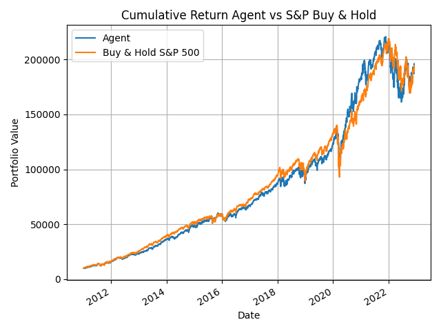

# Invest-AI

A PPO agent that allocates a three-ETF portfolio using the CNN Fear & Greed Index as a
sentiment input.

It rarely beat buy-and-hold on the S&P 500 across nine hyperparameter configurations 

CS 486 research project at Drexel, with Shiv Chavda and Kushagra Mittal.



The agent tracks the index until roughly 2016, then falls behind and ends at about half the
value of holding VOO. Training data covered 2011 to 2016.

## Background

Most reinforcement learning work in trading uses price history and technical indicators, which
implicitly assumes markets behave rationally. Behavioral finance disputes that. The CNN Fear &
Greed Index is a composite of volatility, market momentum, junk bond demand and safe-haven
demand, and few DRL trading systems use it as an input.

We tested whether adding that sentiment signal to the observation space would let a PPO agent
allocate better than a static baseline. It did not.

## Environment

A custom Gymnasium environment simulating daily trading across VUG, VT and QQQ, benchmarked
against buy-and-hold on VOO.

| | |
| --- | --- |
| **Observation** | cash on hand, normalized price per ETF, shares held per ETF, normalized Fear & Greed Index, timestep |
| **Action** | continuous allocation across the three ETFs |
| **Reward** | log of portfolio return per step, so cumulative reward tracks cumulative growth |
| **Frictions** | 0.05% transaction cost on rebalancing, recurring monthly cash contributions |
| **Sentiment** | daily FGI from 2011 to 2023, aligned to trading days, missing values set to 0.5 |

The action space is continuous rather than discrete buy/sell/hold, so the agent outputs
weights and the environment handles rebalancing.

## Results

Nine models: learning rates of 0.001, 0.005 and 0.01 crossed with discount factors of 0.01,
0.5 and 0.99, each trained for 1,000,000 timesteps.

- The agent rarely outperformed buy-and-hold on VOO.
- Performance was closest to the index between 2011 and 2016, the period it trained on.
- Gamma 0.5 produced the most balanced allocations. Gamma 0.01 produced the most skewed, with
  the agent concentrating in QQQ.
- Gamma 0.01 gave the highest average cumulative returns, which contradicts the literature
  where 0.99 is standard.

Fear & Greed Index data alone was not sufficient to make a PPO agent viable here.

## Note on the baseline paper

We also ran the environment with AAPL, GOOG and META in place of the ETFs, and the agent beat
buy-and-hold on the S&P comfortably.

The paper we benchmarked against reported strong PPO results on a Google, Microsoft and Meta
portfolio, over a period when those stocks outperformed the index on their own. Since swapping
the assets flips our result without changing the algorithm, some of those published gains may
reflect asset selection rather than agent performance. We did not test this properly and it
remains a hypothesis.

## Known weaknesses

- The evaluation window overlaps the training window. Models trained on 2011 to 2016 were
  tested across 2011 to 2023, so early performance is in-sample. Walk-forward validation on
  rolling windows would be the correct approach.
- One seed per configuration, so no variance estimate across runs.
- Three assets only. The environment generalizes but was not tested at realistic portfolio
  size.
- This is a study of environment design and RL behavior, not investment advice.

## Running it

```bash
pip install -r requirements.txt
cd environment
python scraper.py    # fetch Fear & Greed and price data
python train.py      # train; writes ppo_invest_ai
python test.py       # evaluate, write plots
```

`train.py` ships with learning rate 0.01 and gamma 0.99. Change those to reproduce any of the
nine configurations.

## Team

**Pedro Braga** built the environment: step logic, reward function, continuous allocation,
transaction costs, monthly contributions and the buy-and-hold baseline. Exposed the PPO
hyperparameters for sweeping, built the plotting, ran training and debugging across the sweep,
and wrote the results analysis and conclusion.

**Shiv Chavda** led the research write-up and the CSV data extraction, and trained and tested
models.

**Kushagra Mittal** built much of the training codebase and the PPO implementation, and found
and fixed a logic flaw that had been producing unrealistically good results.

Full write-up with all nine result sets: [InvestAI_Report_ResearchPaper.pdf](InvestAI_Report_ResearchPaper.pdf).
